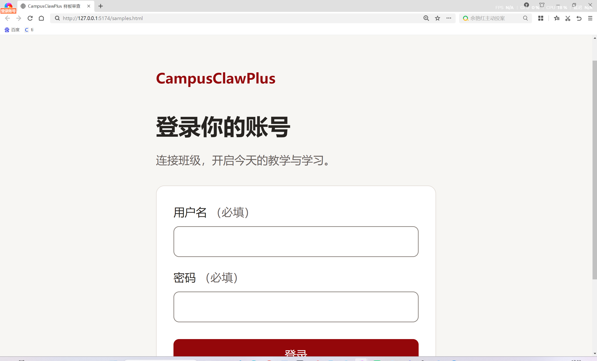

# 02代表样板确认

小张（zwh9616，AI辅助），2026-11-07。样板源码仍为b078747/fcdf726；本提交只整合main55f0e83门禁、更新确认及证据，不修改UI。

小张此前已实开360/1440及767/768，独立复跑12项加载/长错误组合和登录错误焦点、切班展开/收起、退出反馈；输入/次按钮边界实测3.632:1，主按钮白字9.154:1、键盘焦点2px。原小葛24项浏览器组合、两档同源码截图及反例保留。按钮默认/悬停/按下/焦点/禁用/忙碌规则已结合源样式审查，未发现阻断布局方向的问题，不把源样式审查冒称全页面逐态截图。

用户小张在原生浏览器手动设置并明确回复“这是200%”，提供当前登录页截图。AI只复核图像：单列表单和标题可读，无横向挤出、相互覆盖；下方操作随页面纵向滚动。原图未经AI修改，元数据和SHA在同名JSON；不声称自动读取了浏览器缩放数值、CSS视口或自动控制Windows通过。

结论：完成tasks2.3的代表样板方向确认，允许小葛继续既有02登录/最小工作台/账号页与真实客户端。此次只收口样板阶段，不批准整个实现PR或归档；3.5的全页面、全部交互态及账号页原生200%仍待实现后实测，4.1独立失效/迟到响应及4.2 MySQL/HTTPS真实联验仍待办。mock证据不能代替真实认证。

合并main时保留统一gate及check:sample-isolation，没有移除原回归。新head检查以实际CI为准，G3仍按#17共同记录，不代小陈确认。
